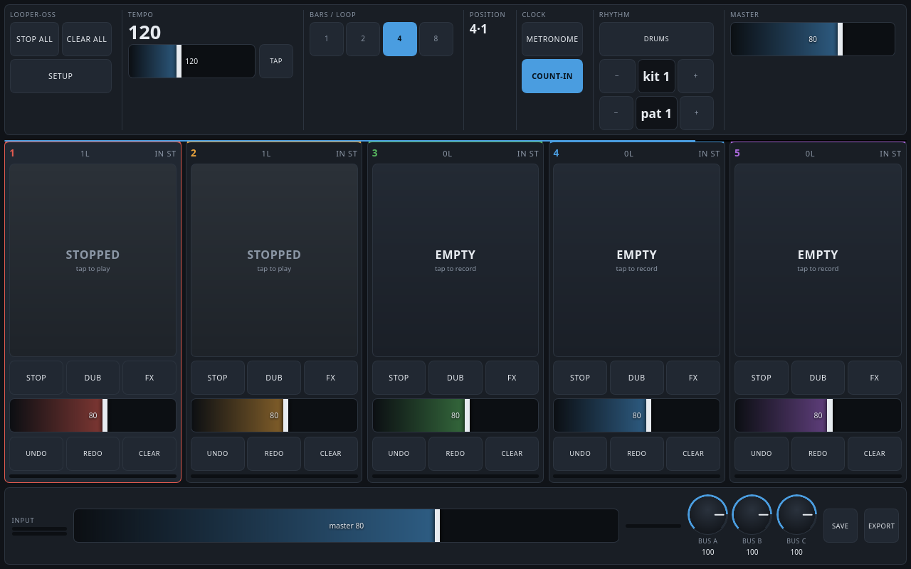
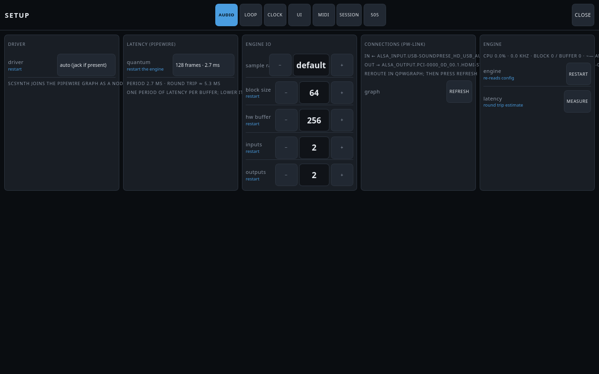
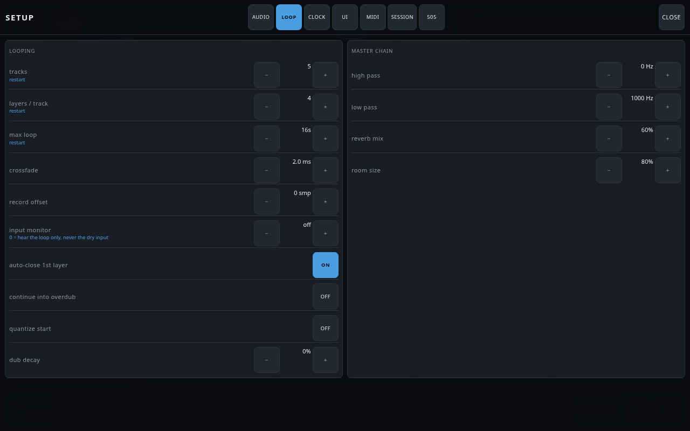
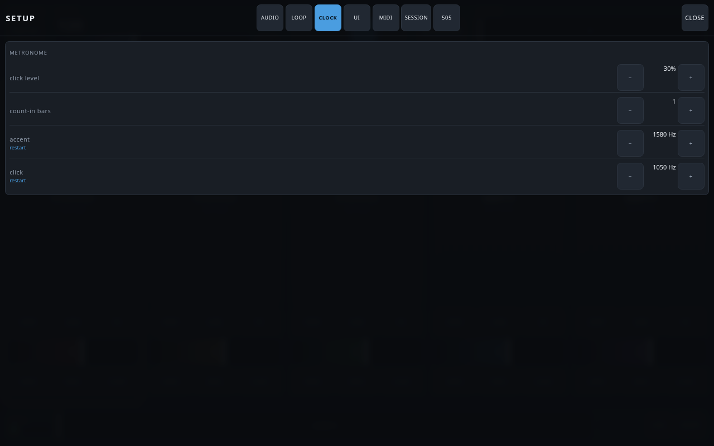
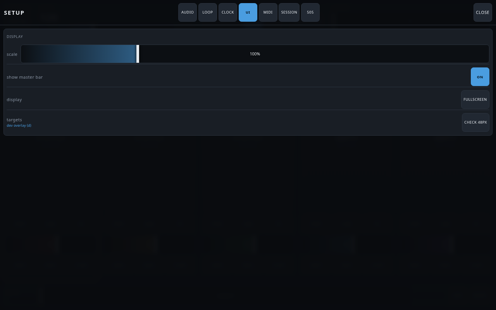
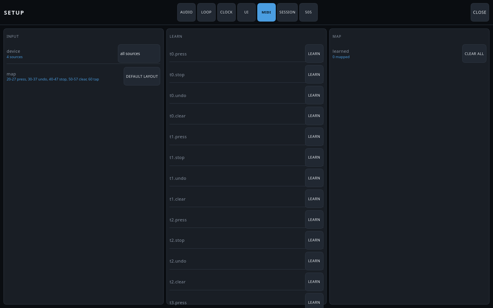
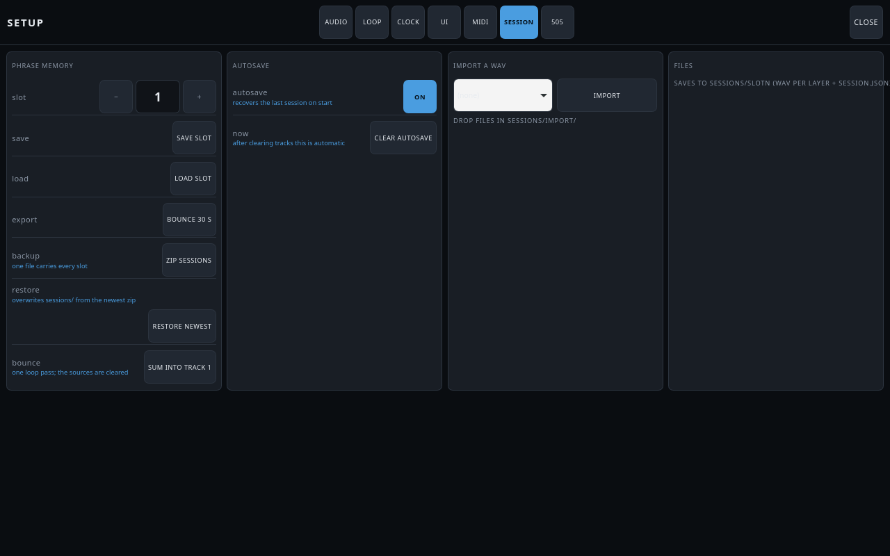
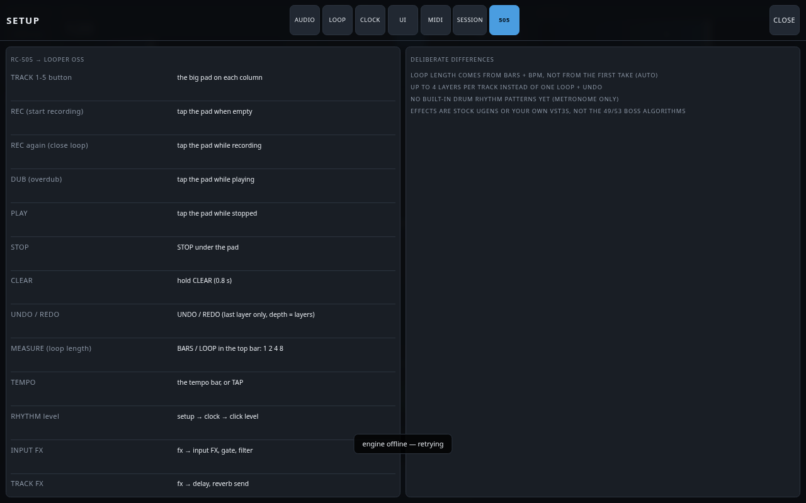
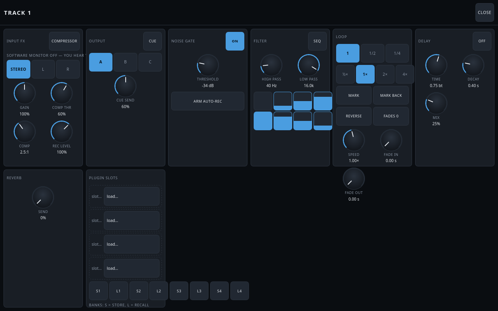

# Looper OSS

A touchscreen loop station in the spirit of the Boss RC-505, built as a thin
skin over **SuperCollider**. Layers per track, tempo-locked loops, per-track
gate / filter / delay / reverb send, MIDI footswitch, VST3 inserts, and session
recording with autosave. Runs fully offline on Linux and Windows.

Nothing in this repo implements audio DSP. Audio is stock SuperCollider UGens;
the UI is a browser page; the only Python translates OSC to JSON.

## What you get

- **A parametric track count, not a fixed layout.** 1 to 16 tracks, chosen in
  setup → tracks or in `ui/config.json`; the grid divides the width it has, so
  2 tracks on a small panel and 16 on a 4K screen are the same code. Each track
  carries 1–4 layers (that count is your undo depth). Audio in and out are
  separately parametric too, 1–16 channels each.
- **Built for a finger, not a mouse.** Every target is at least 48 px in both
  axes (`--tap`), driven by pointer events with `touch-action: none`, no
  hover-only affordances, and a 0.8 s long-press guard before anything
  destructive happens. `--browser` gives an app window, `--kiosk` gives a bare
  fullscreen panel; press `d` to outline every target and count any below the
  floor.
- **Any panel or monitor**, 1024×600 up to 4K, portrait or landscape, rescaled
  by one slider (0.75–1.75) that persists.
- **No build step, no framework, no network at runtime.** Offline by
  construction.

```text
app/            the desktop application: window, launcher, shutdown
ui/            browser UI (HTML/CSS/JS, no build step, scales to any screen)
bridge/        bridge.py — OSC <-> WebSocket JSON, + config writer
engine/        looper.scd — UGen wiring and the per-track state machine
               vst.scd   — VSTPlugin slots, loaded only if the extension exists
packaging/     linux/ (AppImage) and windows/ (PyInstaller + Inno Setup)
scripts/       smoke.py (e2e test), uicheck.mjs (UI test), sweep.py, release.py
docs/          PROTOCOL.md, CONTROLS.md, AUDIO.md, LICENSING.md, img/ (screenshots)
ui/config.json the only config file
install.sh     one-time setup for a source check-out
VERSION        the release number, read by scripts/release.py
goal.md        what was built, in phases, with acceptance criteria
FEATURES.md    feature inventory: shipped / planned / backlog
```

## Requirements

| what | why | where it comes from |
| --- | --- | --- |
| **SuperCollider 3.13+** (`sclang`, `scsynth`; tested on 3.14.1) | the entire audio engine | your OS package manager |
| **sc3-plugins** | the per-track filter (`BLowPass` / `BHiPass`) | your OS package manager |
| **Python 3.9+** + PyGObject | the bridge, the tests, and the app window | your OS package manager (already there on any GTK desktop) |
| an audio server | PipeWire on Linux, WASAPI on Windows | already on your desktop |
| *optional* **VSTPlugin** | VST3 / VST2 insert slots | see [Install](#install) |
| *optional* **chromium / firefox** | `--browser` and `--kiosk` app window | already installed |

That is all of it. No build step, no JavaScript toolchain, no database, no
network access at runtime. The two Python packages the bridge needs are pinned
exactly in [`requirements.txt`](requirements.txt) and installed into a local
`.venv`; nothing is installed system-wide and nothing needs `sudo`.

## Get it

**Release archive** — no git required. Take `looper-oss-<version>.tar.gz` (or the
`.zip`, which keeps the Unix modes for Windows users) from the
[releases page](https://github.com/benjamin-nimmerrichter/looper-oss/releases),
check it against the published `SHA256SUMS`, unpack it, and continue at
[Install](#install).

**From source:**

```bash
git clone git@github.com:benjamin-nimmerrichter/looper-oss.git
cd looper-oss
```

**To build the archive yourself** — a USB stick, a pedal image, an offline
machine — run `./scripts/release.py`. It writes
`dist/looper-oss-<version>.tar.gz`, a `.zip` with executables still executable,
and `SHA256SUMS`; it refuses to ship `sessions/`, `logs/`, `.venv/` or the
generated `engine/_config.scd`, and it rebuilds byte-identically.

## Install

**Linux — AppImage.** Download `looper-oss-<version>-x86_64.AppImage`, make it
executable, run it:

```bash
chmod +x looper-oss-0.1.0-x86_64.AppImage
./looper-oss-0.1.0-x86_64.AppImage
```

That is the whole installation. In a file manager, right-click → *Properties* →
allow executing, then double-click; if you have AppImageLauncher it will offer
**Integrate and run**, which adds Looper OSS to your application menu (it then
moves the file into `~/Applications`, so look there if it seems to disappear).

**What is inside, and what it installs for you.** The AppImage carries the whole
Python side — a CPython plus `websockets` and `python-osc` — so there is nothing
Python to install. Four things stay the operating system's:

| | why it is not in the bundle |
| --- | --- |
| SuperCollider (`sclang` + `scsynth`) | it is the audio server, like PipeWire: it links against the system's libjack, libpipewire, libsndfile and libsystemd, and a bundled copy would fight the host's |
| `sc3-plugins` | extra UGens the engine's SynthDefs use |
| GTK 3 + WebKit2GTK + PyGObject | the window is the desktop's, built against its own Python and GTK |
| PipeWire / JACK | your audio driver |

Those are not bundled because of what they cost: measured on the build machine,
the GTK 3 + WebKit2GTK closure is **281 MB in 138 libraries** (WebKit alone
98.6 MB, JavaScriptCore 40.6 MB, ICU 33.1 MB) and SuperCollider's is **477 MB in
242** (sclang links Qt6WebEngine, 203.7 MB of it). Bundling both would make a
~300 MB AppImage that only runs within the same glibc generation. A 12 MB
download plus one password prompt is the better trade; `goal.md` records the
numbers and the conditions under which a full bundle would be worth it.

You do not hunt for those package names. The app knows what is missing, spells
it correctly for your distribution, and installs all of it behind one password
prompt:

```bash
./looper-oss-0.1.0-x86_64.AppImage --install-deps
```

`--deps` reports what it found without changing anything. `pipewire-jack` is
what puts scsynth on the PipeWire graph like any other client; if you keep
`jack` (jack2) instead, choose driver **alsa** in setup → audio and pick your
interface there.

**Windows.** Run `looper-oss-<version>-setup.exe` — a per-user install, so no
administrator password — or unzip the portable build and double-click
`LooperOSS.exe`. Install [SuperCollider for Windows](https://supercollider.github.io/)
once; without it the app opens a window that says exactly that, instead of
dying quietly.

**Windows is not supported yet.** The PyInstaller/Inno Setup recipe and the
`driver = asio` code path exist, but no Windows host has run them, so a Windows
build is an experiment rather than a release. Windows becomes its own task:
verify under Wine first, then on real hardware. Everything else in this document
was verified on CachyOS + PipeWire.

**From source** (development):

```bash
git clone git@github.com:benjamin-nimmerrichter/looper-oss.git
cd looper-oss
./install.sh              # .venv, pinned requirements, engine config
python3 looper_oss.py     # and you are playing
```

`./install.sh` checks every system dependency (audio engine, plugins, window)
and prints one command that fixes whatever is missing; `./install.sh
--install-deps` runs it for you behind a single password prompt.

Optional, VST3 inserts: the `VSTPlugin` extension (AUR `sc3-vstplugin`, or the
prebuilt release zip from `github.com/Spacechild1/vstplugin` unpacked into
`~/.local/share/SuperCollider/Extensions/`). The engine detects it at startup and
shows `VST yes` in the log; without it the slots are simply absent.

## Run

There is no script to remember and no terminal to keep open. Start the app and
you get a window:

| you want | do this |
| --- | --- |
| start it | click **Looper OSS** in the application menu, or double-click the AppImage / `LooperOSS.exe` |
| a pedal, not a window | set it fullscreen in setup → UI, or start once with `--kiosk` |
| quit | close the window — engine, bridge and interface server stop with it |
| start it twice | the second click raises the running window instead of fighting over ports |
| see what went wrong | `logs/` beside the app; packaged builds keep them in `~/.local/share/looper-oss/app/<version>/logs/` |

Closing the window stops the audio engine on purpose: a looper that keeps a
`scsynth` alive after you quit is a looper that steals your audio device.

## Playing it

| gesture | effect |
| --- | --- |
| tap a track pad (empty) | record layer 1 |
| tap while recording | close the layer, it loops |
| tap while playing | record another layer on top |
| **undo / redo** | drop or restore the last layer, instantly |
| **clear** (tap twice) | wipe the track: tap once → `sure?`, tap again to confirm |
| **clear all** (tap twice) | wipe *every* track and the autosave — a clean slate |
| **stop** | silence the track, keep its layers |
| **fx** | per-track drawer: input, gate, filter, loop, delay, reverb, plugin slots |
| **setup** | audio device, loop, clock, UI scale, MIDI learn, sessions |
| tap the BPM bar / **tap** button | set tempo, or tap tempo |
| **count-in** | next recording waits for the bar |

Keyboard on the laptop: `1`–`8` press a track, `u` undo, `s` stop, `space` stop
all, `esc` close a drawer, `d` toggle the 48 px target overlay.

The **position** readout next to the clock counts your place in the loop as
`bar·beat` (`3·2` = third bar, second beat), wrapping with the blue playhead so
you can count a four-bar phrase without watching the line.

### Two instruments, one interface

The record source is **per track**, so a microphone and a guitar plugged into the
same 2-channel interface are two independent loops:

| track | fx → input FX | header badge | records |
| --- | --- | --- | --- |
| 1 — voice | `L` | `IN L` | channel 1 only |
| 2 — guitar | `R` | `IN R` | channel 2 only |

`stereo` sums both channels (×0.7071, so it cannot clip) and records the sum to
both sides — right for a stereo keyboard or a stereo pedal. `L` / `R` take one
channel and record it to both sides — right for a mono mic and a mono guitar.
On a wider interface the list keeps going (`ch 3`, `ch 4`, … up to
`setup → audio → inputs`, which is how many input channels the engine opens).
The badge in the track header shows the choice without opening anything.

## How loops stay in sync

One `Phasor` writes loop phase to an audio bus; every track derives its own
phase from it, so layers can never drift and a track can run at half or a
quarter of the master loop (`loopRatio`). Overdub is a `BufWr` into a free layer
buffer while the others keep playing, and undo is just that layer's gain going
to zero — which is why it is instant and needs no buffer arithmetic.

A short fade at the loop seam kills the wrap click. `contentLen` (frozen per
track when it first records) versus the live grid length is what makes a tempo
change a free varispeed instead of a re-record. Details and gain staging in
`docs/AUDIO.md`.

## Sessions

- **save slot** (footer or setup → session) writes `sessions/slotN/`: one WAV per
  layer, `session.json` with the whole UI state, `vst.txt` + `vst_*.bin` for
  plugin state.
- **load** restores layers, plugin chain and plugin state.
- **autosave** writes `sessions/autosave/` whenever the layer structure changes
  and nothing is recording; a cold start recovers it automatically. A crash
  costs at most one layer.
- **export** bounces 30 s of the master bus to `sessions/exports/`.

## The setup screen, explained



The **setup** button (bottom left) opens a drawer with seven tabs. Nothing here
needs saving: every change is written to `ui/config.json` as you touch it and is
there next time you start. Where a row says **restart**, close the window and
open the app again — that setting is read once, while the engine boots.

If you only ever change one thing, make it **setup → audio → quantum**: it is the
difference between "this feels tight" and "this feels laggy", and it is not the
looper's fault.

### audio — where the sound goes, and how fast



| control | what it does | sane value |
| --- | --- | --- |
| **driver** | how the engine reaches your interface. *auto* uses JACK/PipeWire if it exists, otherwise ALSA. *jack / pipewire* forces the shared graph, where other apps coexist with you. *alsa* takes the device directly and **nothing else can use it** while you play. | auto, unless you are on a pedal with a dedicated card |
| **quantum** | PipeWire's buffer. Lower = less delay between your hands and your ears, higher = the machine stops crackling. This is *the* latency control. | 256 (≈5 ms per period) on a decent machine, 128 for the pedal, 1024 if audio breaks up |
| **sample rate** | 44.1k or 48k, or *default* to follow the system | default |
| **block size** | SuperCollider's own computation block. Ignored under JACK/PipeWire, where the graph decides | leave at 64 |
| **hw buffer** | hardware buffer for the ALSA path only | leave alone unless you hear dropouts |
| **inputs / outputs** | how many channels the engine opens, 1–16 each | 2 in, 2 out |
| **connections (pw-link)** | what is actually patched into and out of the engine, read live from the graph. If meters move and you hear nothing, this is the row that tells you why | reroute in `qpwgraph`, then press **refresh** |
| **engine → restart** | rebuilds the engine without quitting the app, after an audio change | — |

### loop — the behaviour of the looper itself



| control | what it does | sane value |
| --- | --- | --- |
| **tracks** | how many columns, 1–16. Each track is an independent looper with its own input, effects and layers. Fewer tracks = bigger pads = easier with gloves. | 5, like an RC-505 |
| **layers / track** | how many overdubs stack up, 1–4. It is also your undo depth: 4 layers = undo 3 times. | 4 |
| **max loop** | the length reserved for each layer, 4–120 s. Memory is tracks × layers × this, so 16 tracks × 4 layers × 120 s is a lot. | 16 s unless you play long phrases |
| **crossfade** | a tiny fade where the loop wraps. Turn it up if you hear a click at the seam; 2 ms is inaudible on most material. | 2 ms |
| **record offset** | nudges when recording starts, in samples, if your takes consistently land early or late. Calibrate by ear against the metronome; ±8 ms is the usual range. | 0 until you hear a problem |
| **input monitor** | lets the dry input through while you record, so you hear yourself in headphones. *off* means you only hear the loop. | off, unless you record with headphones |
| **auto-close 1st layer** | the first take closes itself at the end of the bar instead of waiting for a second tap | on |
| **continue into overdub** | after closing the first layer it drops straight into overdubbing, RC-505 style. Off = it starts playing and waits for you | on |
| **quantize start** | snaps the beginning of a recording to the bar grid | off if you want free timing |
| **dub decay** | each overdub pass fades the previous layer a little — "sound on sound" fade-out. 0 % keeps everything forever. | 0 %, raise it for ambient layering |
| **master chain: high pass / low pass** | a filter across the whole mix, for taming rumble or hiss | 0 Hz / 1000 Hz+ is off |
| **master chain: reverb mix / room size** | one shared reverb; each track has its own send in the fx drawer | 60 % mix, 80 % room |

### clock — what you play to



| control | what it does | sane value |
| --- | --- | --- |
| **click level** | metronome loudness, on its own bus so it never lands in your loop | 30 % in headphones, 0 % live |
| **count-in bars** | how many bars the **count-in** button waits before recording starts, 0–8 | 1 |
| **accent / click** | pitch of the first beat and of the other beats. Higher cuts through a loud room | 1580 Hz / 1050 Hz |

Tempo itself lives on the main screen: drag the tempo bar, type a number, or tap
**TAP** in time. Bars per loop is the **1 2 4 8** row next to it — that is the
loop length, so 4 bars at 120 BPM is 8 seconds.

### ui — how big everything is



| control | what it does | sane value |
| --- | --- | --- |
| **scale** | enlarges or shrinks the whole interface, 75–175 %. For a pedal at arm's length, bigger; on a laptop, smaller | 100 %, around 125 % on a small panel |
| **show master bar** | the master volume/meter strip at the bottom | on |
| **fullscreen** | the browser's fullscreen mode, for a pedal | — |
| **check 48px** | outlines every interactive target and counts the ones below 48 px — the minimum for a finger. Keyboard `d` does the same | press it once on the real screen |

### midi — a footswitch or a controller



| control | what it does |
| --- | --- |
| **device** | which MIDI source to listen to, or *all sources* |
| **map → default layout** | one press lays out the usual footswitch: notes 20–27 press a track, 30–37 undo, 40–47 stop, 50–57 clear, 60 tap tempo |
| **learn** (per row) | press *learn* next to an action, then move the knob or press the pedal you want to use. The row renames itself to what it learned |
| **map → clear all** | forget every learned control |

Targets you can learn: per track `press`, `stop`, `undo`, `clear`, plus the
global `tap`, `stopAll` and `metro`. Anything with a CC works too — a slider can
be the master volume.

### session — keeping what you played



| control | what it does |
| --- | --- |
| **slot** (1–8) | which phrase memory the next save or load uses |
| **save slot** | writes that slot: one WAV per layer, `session.json` with the whole state, and your VST plugin settings |
| **load slot** | restores it, layers and plugins, and starts playing |
| **bounce 30 s** | records 30 seconds of the master output to `sessions/exports/` — the quickest way to get an idea onto disk |
| **autosave** | when on, the current layers are written whenever the structure changes and nothing is recording, so a crash costs at most one overdub |
| **clear autosave** | throws that recovery copy away. Clearing a track does it for you |

A session lives in `sessions/slotN/` beside the app (packaged builds:
`~/.local/share/looper-oss/app/<version>/sessions/`). Copy that folder to back
something up; it is self-contained.

### 505 — the translation table



Read-only, and worth one look if you know an RC-505: it maps every Boss control
to what you do here — REC/DUB/PLAY/STOP/CLEAR/UNDO, MEASURE, TEMPO, RHYTHM
level, INPUT FX/TRACK FX/MASTER FX, SPEED CHANGE, MEMORY, and LOOP SYNC off. It
also lists the four places where this deliberately differs from the hardware
(loop length from bars and tempo, four layers instead of one loop plus Mark
Back, no drum patterns yet, and your own VSTs instead of the Boss algorithms).

## The fx drawer



**FX** under a track opens its channel strip: **input** (which hardware channel,
trim, hot indicator), **noise gate** (threshold and smoothing), **filter**
(high/low pass), **loop** (reverse, fade in/out, per-track length — 1, ½, ¼),
**delay** (tempo-synced), **reverb send**, and **plugin slots** for VST3/VST2.
Everything there is per track, and it all saves with the session.

## Scaling

`ui/config.json` → `tracks` (1–16) and `maxLayers` (1–4). The track grid is
`grid-auto-columns: 1fr`, so the columns divide whatever width there is. Every
dimension is in `rem`, and

```css
html { font-size: calc(clamp(9px, min(1.62vh, 1.05vw), 26px) * var(--scale)); }
```

so the whole pedal rescales from 1024×600 to 4K, portrait or landscape, and the
**scale** slider (setup → UI, 0.75–1.75) sets `--scale` for the room you are in.
Every interactive target is at least 48 px in both axes (`--tap`); press `d` to
have the UI outline each target and count any that fall below that floor.

## Tests

```bash
./install.sh                          # .venv + pinned requirements
./scripts/smoke.py                    # starts its own engine: 45 end-to-end checks
./scripts/smoke.py --attach            # run against a stack you already started
PLAYWRIGHT_DIR=/tmp/uitest/node_modules ./scripts/uicheck.mjs
./scripts/release.py --check           # is the tree shippable? builds nothing
./packaging/linux/build-appimage.sh    # dist/looper-oss-<ver>-<arch>.AppImage
```

`smoke.py` needs the venv's packages only; it finds `.venv` itself, so you never
have to activate anything first. It also **wipes `sessions/autosave`,
`sessions/slot7` and `sessions/exports`** before it starts — copy them elsewhere
if one of them is yours.

`./scripts/wavcheck.py` inspects the WAVs a session slot wrote — offline, silent —
and reports whether each take ends cleanly at the loop point (`STEP into the final
frame`).

`smoke.py` drives the real protocol: state shape, record → auto-close →
overdub → undo → redo → stop → resume, varispeed, reverse, loop length, dub
decay, crossfade, record offset, stats, device enumeration, session save/load,
autosave recovery and export.

`uicheck.mjs` needs playwright (`mkdir -p /tmp/uitest && cd /tmp/uitest &&
npm i playwright && npx playwright install chromium`). It checks layout fit at
1280×800 / 1024×600 / 1920×1080 / 800×1280, the 48 px floor in the main view and
both drawers, that tapping a pad changes engine state, that the scale slider
works and persists, and writes screenshots to `/tmp/looper-oss-ui/`.

## Troubleshooting

| symptom | cause |
| --- | --- |
| a window that says *SuperCollider was not found* | install SuperCollider (see [Install](#install)); the app will not fake an engine |
| *something else is using that port* | another Looper OSS is already running — use its window; or change `ui` → `port` in `ui/config.json` |
| UI says *engine offline* | check `logs/bridge.log` and `logs/engine.log` (packaged: `~/.local/share/looper-oss/app/<version>/logs/`) |
| the app closes by itself a few seconds after starting | no interface stayed connected — that is the intended shutdown; start it from the menu rather than the raw port |
| silence but meters move | output routed to the wrong sink — patch `SuperCollider:out_1/2` in `qpwgraph` |
| click at the loop point | raise `loop.crossfadeMs` (setup → loop) |
| loops land late | calibrate `loop.recordOffset` (setup → loop) |
| high latency | PipeWire quantum; `pw-metadata -n settings 0 clock.force-quantum 256` |
| no output after the laptop wakes from sleep | handled: the app notices the resume and restarts the engine, because the audio device is torn down and rebuilt while `scsynth` keeps running silent. The session comes back stopped — press a pad. `logs/app.log` says `resume detected` when it fired. |

Logs are in `logs/`, rotated at 5 MB. Closing the window stops the engine,
the bridge and the interface server together — if a crash ever leaves an
`scsynth` behind, the next start clears it.

## Credits

Looper OSS is a thin skin over other people's work, and says so in
[`ACKNOWLEDGEMENTS.md`](ACKNOWLEDGEMENTS.md): SuperCollider, sc3-plugins,
VSTPlugin, python-osc, websockets, PipeWire, and the RC-505 and SooperLooper
designs this imitates on purpose.

## Licence

**GPL-3.0-or-later** — see [`LICENSE`](LICENSE). This repository ships no
third-party code; [`docs/LICENSING.md`](docs/LICENSING.md) has the full
attribution table, what is imported versus merely launched, and what
redistributing a pedal built on this actually obliges you to do.

## Docs

- `AGENTS.md` — where everything lives, the commands, and the invariants that bite
- `docs/CONTROLS.md` — **every button, slider and knob**, with range, effect and the message it sends
- `docs/PROTOCOL.md` — every OSC/JSON message, with field order
- `docs/AUDIO.md` — signal graph, gain staging, latency, CPU numbers
- `goal.md` — the plan this was built against, phase by phase
- `FEATURES.md` — feature inventory and backlog
